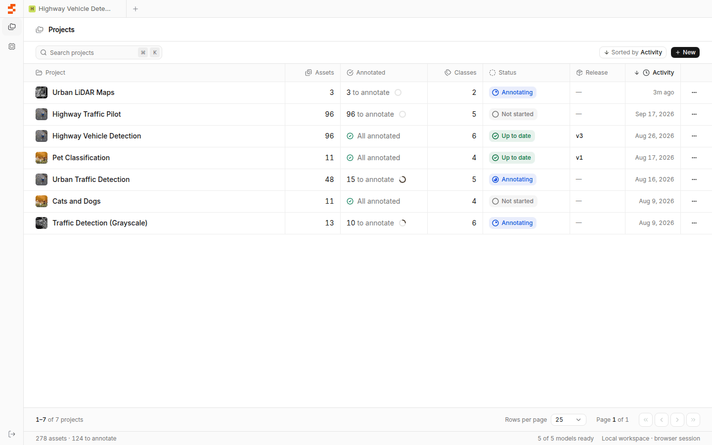
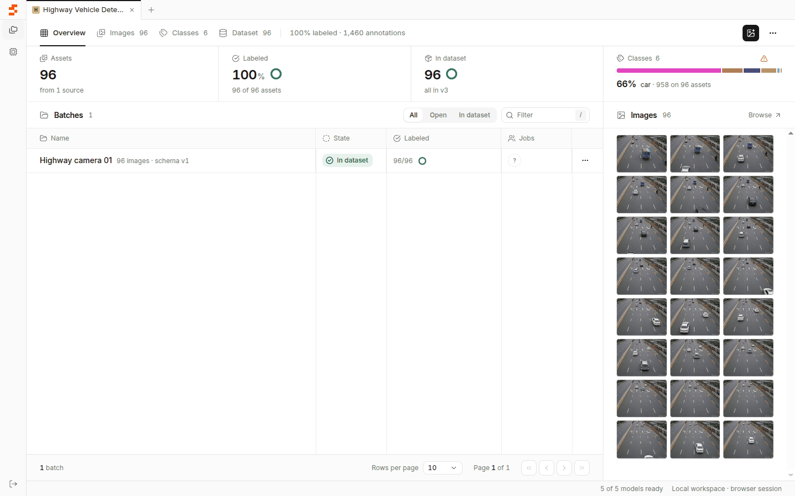
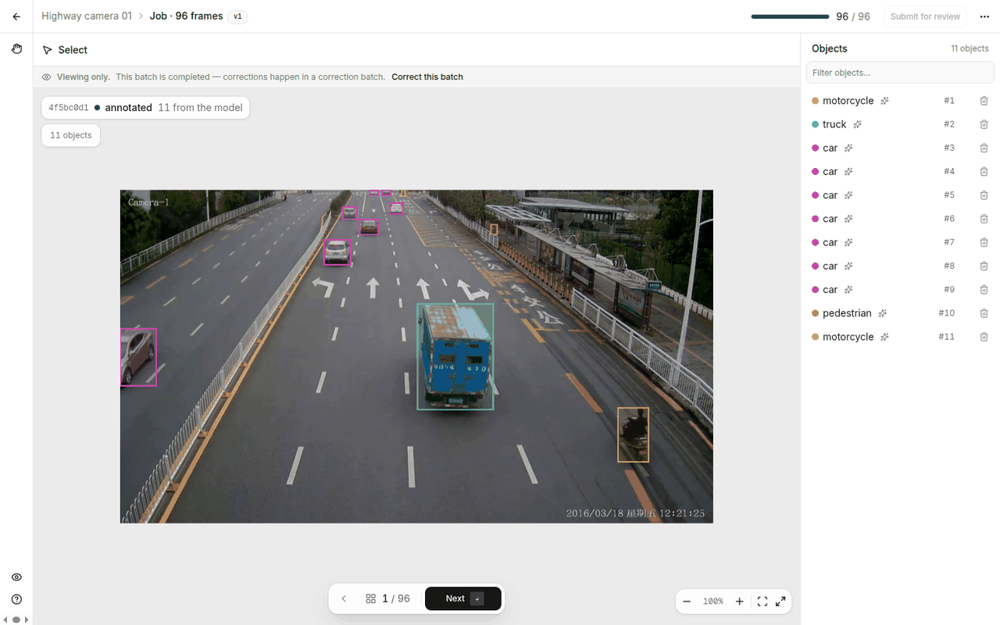
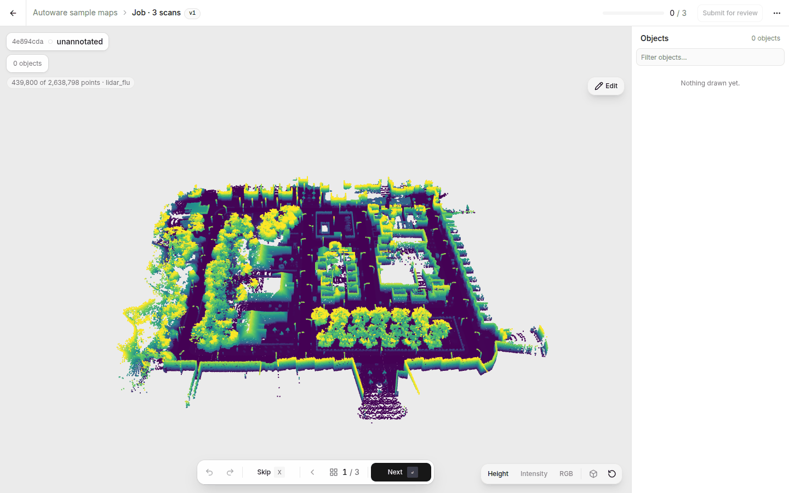

-----

# Robomous VisionSet

[](https://github.com/robomous/visionset/actions/workflows/ci.yml)
[](https://pypi.org/project/visionset/)
[](https://pypi.org/project/visionset/)
[](https://pypi.org/project/visionset/)
[](https://pypi.org/project/visionset/)
[](https://pypi.org/project/visionset/)
[](LICENSE)

**VisionSet** is an open-source tool by [Robomous](https://robomous.ai) for creating, curating,
and versioning computer-vision training datasets. Annotate images, video frames, and point-cloud
scans in a local workspace. The browser app, REST API, CLI, and MCP server all use the same Python
SDK and ship in one installable package.

## See it

The shots below are the app on a local workspace: frames cut from a traffic clip and labeled with
boxes, and three point-cloud maps ingested as scans.









## What it does

Bring in raw media or an existing labeled dataset, review the annotations, and export a version
for training. Open the browser app for video import and interactive annotation. The REST API and
MCP can also write annotations. Use the CLI to ingest media, manage work, and publish or export a
release. See the [interface comparison](docs/content/surfaces.md) for the full list.

| | |
| --- | --- |
| **Ingest** | Add folders of images or PCD and PLY scans. Import video frames in the browser. VisionSet stores identical media bytes once. |
| **Import labels** | Bring in an existing dataset through the CLI or MCP. The import creates an approved batch with provenance so you can review it before promotion. See [supported formats](docs/content/import.md#formats). |
| **Annotate** | Draw labels on images and point clouds. The browser editor provides keyboard shortcuts and undo and redo. See [supported geometries](docs/content/annotations.md). |
| **Version** | Each label records the schema version it was validated against. Publishing a release freezes the dataset in an immutable manifest. |
| **Split** | A seeded recipe keeps identical assets in the same split. Assets with the same imported group label can also be kept together. See [releases](docs/content/releases.md). |
| **Export** | Pick a [training target](docs/content/releases.md#export-targets) or format. The compatibility report shows which annotations or assets it would drop before writing files. |
| **Pre-process** | Use a [recipe](docs/content/preprocessing.md) to resize images and create augmented variants for the training split. The export report records the recipe. |
| **Auto-label** | Configure a model for [interactive suggestions or batch pre-labeling](docs/content/inference.md). Accepted suggestions record model provenance. |
| **Automate** | Use the Python SDK, REST API, CLI, or MCP server to manage the workflow. |

## Quickstart

```bash
uv tool install --prerelease allow visionset

visionset init ~/datasets/road-signs     # a workspace, here and nowhere else
cd ~/datasets/road-signs
visionset server                         # API at http://127.0.0.1:8000, app at /app
```

Open `http://127.0.0.1:8000/app`. The [tutorial](docs/content/tutorial.md) takes you from source
images to a YOLO export. The examples and feature descriptions follow `main`. See the
[installation guide](docs/content/install.md) to build a wheel from the current checkout.

To connect an MCP client to a workspace, add this configuration:

```json
{ "mcpServers": { "visionset": {
    "command": "visionset", "args": ["mcp"],
    "env": { "VISIONSET_WORKSPACE": "/path/to/workspace" } } } }
```

See the [MCP setup guide](docs/content/mcp.md), [tool reference](docs/content/mcp-tools.md), and
[end-to-end walkthrough](docs/content/mcp-walkthrough.md). On `main`, Codex and Claude Code can
also use the [agent plugin](agent-plugins/README.md), which launches a compatible installed CLI.

You can also manage the workflow from the terminal and label the images in the browser:

```bash
visionset project create road-signs
visionset schema apply schema.json --project road-signs
BATCH=$(visionset ingest ./incoming --project road-signs)
visionset batch approve "$BATCH" --jobs-of 100 --start
# …label in the app, then…
visionset batch finish "$BATCH" --promote
visionset release publish --tag v1.0 --project road-signs --split 0.7,0.15,0.15
visionset export --project road-signs --release v1.0 --target yolo11 --check
# If the reported losses are acceptable:
visionset export --project road-signs --release v1.0 --target yolo11 --out ../road-signs-yolo --allow-lossy
```

Commands with structured output accept `--json` and use the same field names as the API. See
[docs/content/cli.md](docs/content/cli.md), or [`examples/cli_end_to_end.sh`](examples/cli_end_to_end.sh) for that
walk with its assertions still in it.

Prefer to see the SDK first? [`examples/sdk_end_to_end.py`](examples/sdk_end_to_end.py) drives an
empty directory to a hash-verified release in one pass, generating its own images — no server,
no CLI, nothing to download. Run it with `uv run python examples/sdk_end_to_end.py`; the
walkthrough is in [docs/content/examples.md](docs/content/examples.md).

For where the assets themselves come from,
[`examples/ingest_end_to_end.py`](examples/ingest_end_to_end.py) turns a folder of generated stills
into 50 deduplicated assets in an approved batch, then shows a re-run creating nothing. It needs
nothing on the host. Starting from a video is a browser capability and has no script form: see
[docs/content/ingest.md](docs/content/ingest.md).

The same cycle runs over each of the other two surfaces, and both start the shipped command for
real: [`examples/http_end_to_end.py`](examples/http_end_to_end.py) starts `visionset server` on a
free port and drives the API with `urllib` and a bearer token — multipart upload, 202-and-poll
ingest, hash-checked manifest and a 401 it asserts — while
[`examples/mcp_end_to_end.py`](examples/mcp_end_to_end.py) spawns `visionset mcp` and talks
JSON-RPC down its pipe, scaling every box out of the preview it saw and into the asset's own
pixels.

## Monorepo map

```
src/visionset/          Single Python distribution (one wheel, one import namespace)
  kernel/               Hexagonal core: domain + ports + default adapters (framework-free)
  wire/                 The JSON shapes the CLI and MCP publish (gated against the REST models)
  server/               FastAPI — exposes the SDK via REST; openapi.json is a committed contract
  cli/                  Typer CLI (`visionset` console script)
  mcp/                  MCP server (stdio) — 66 agent tools over the same SDK, four more on request
  formats/              Exporter plugins: ultralytics, yolov5-yaml, darknet, yolo-obb, dota, coco,
                        coco-panoptic, segmentation-png, voc, labelme, createml, open-images,
                        tfrecord, classification, classification-dir, the five lane formats, mot,
                        cvat-images and cvat-video;
                        importer plugins for most of them, plus the kitti and nuscenes scan importers
                        (entry-point group `visionset.formats`)
  preprocessing/        Pre-processing drivers: Pillow resize and augmentation behind the
                        `PreprocessingDriver` port (entry-point group `visionset.preprocessing`)
  jobs/                 Handlers for work that outlives a request: ingest, export, weights
  inference/            Where a model connection becomes a running model (optional runtime)
  _static/              Compiled UI bundle lands here at build time (ships in the wheel)
frontend/
  annotator/            @visionset/annotator — headless annotation engine (no React in core/)
  media/                @visionset/media — browser video import and sampling
  browser-inference/    @visionset/browser-inference — ONNX execution in a browser worker
  ui-core/              @visionset/ui-core — domain components, tokens, generated API contract
  app/                  @visionset/app — OSS product shell (Vite + React, never published)
agent-plugins/          Client manifests, launcher, and end-user skills
tests/                  Python tests, incl. machine-enforced architecture contracts
examples/               Six runnable end-to-end scripts, all exercised in CI
docs/                   Documentation: content/ is the Markdown (user and contributor docs, one page per
                        subsystem); the rest is the Astro + Starlight site that renders it — a view, never a second copy
docker/                 Dev-only compose environment (never the release artifact)
scripts/                Repo automation (OpenAPI export, version sync, bundling, dist build)
.agents/skills/         Coding-agent skills, tool-agnostic (see AGENTS.md)
```

`ui-core` reaches data through a small contract rather than any particular transport, so its
screens are mountable by a host other than this application — the OSS app you see here is one
implementation of that host, not the only one there could be.

## Documentation

Start with [docs/content/install.md](docs/content/install.md) and [docs/content/tutorial.md](docs/content/tutorial.md).
[docs/content/README.md](docs/content/README.md) indexes the rest — one page per subsystem, each written to
explain the decisions rather than restate the code.

**`docs/content/` is the source of truth**, and it is plain Markdown so that it reads on GitHub with
nothing installed. [`docs/`](docs/README.md) renders the same files as a searchable
website; it adds no content of its own. To read it locally:

```bash
docker compose -f docker/compose.yaml up docs    # http://localhost:4321
```

or, without Docker, `pnpm --dir docs install && pnpm --dir docs dev`. Editing anything
under `docs/content/` reloads the page.

## Development setup

```bash
uv sync         # Python env + dev tools
pnpm install    # frontend workspace
```

Then `uv run visionset server` and `pnpm --filter @visionset/app dev`. Or run the whole thing in
containers instead, with nothing installed on the host and nothing built.

### Run it with Docker, and sign in with nothing

```bash
docker compose -f docker/compose.yaml up
```

**Open http://localhost:8080. There is no token to find and nothing to paste** — the app opens on
the project list. The server signs in the browser it served itself, over an `HttpOnly` cookie it
sets on the first request the page makes; [docs/content/auth.md](docs/content/auth.md#the-browser-session) has the
mechanism and the reasoning.

One port, nginx in front of both services. The first run builds two images, every later one just
starts them; dependencies are installed at build time, so starting the stack downloads nothing.

A token is still minted on first boot and printed in the `api` logs, because `curl`, the SDK and
other HTTP clients have no session and never will (MCP needs no token at all):

```bash
docker compose -f docker/compose.yaml logs api | grep vst_    # if you scrolled past it
docker compose -f docker/compose.yaml exec api \
  visionset token create --name <name>                        # or mint another
```

The browser never needs either. If the page *does* ask for a token, the stack is not the one this
README describes — check that `VISIONSET_UI_SESSION: always` is set on the `api` service and that
you are reaching it through port 8080.

> **Why `always` here, and what it costs.** The default, `VISIONSET_UI_SESSION=auto`, issues a
> session only to a client on this machine — and behind a proxy no request ever looks like one,
> because the peer is nginx. So the compose stack says `always`. The front door on 8080 is
> published on every interface, so another device on your network — a phone, a tablet — can open
> the dev stack at `http://<your address>:8080`; the api and vite publish no host port at all. The
> consequence is that whoever reaches 8080 is signed in, so the stack trusts the network it runs
> on. On one that is not yours, set `VISIONSET_UI_SESSION: never` to go back to typing a token,
> or bind the nginx port to `127.0.0.1` in `docker/compose.yaml`.

Everything it stores lands in **`workspace-data/`** (git-ignored): SQLite for metadata, a local
directory for the files, one workspace holding both — the shape MLflow's default mode has, and the
only shape VisionSet has. Put it elsewhere with `VISIONSET_DATA=/path docker compose …`; it is a
bind mount, so `down -v` does not take your data with it.

The containers run as you rather than as root, so everything they write there — and every
`__pycache__` and generated page elsewhere in the checkout — belongs to the account that started
them, and a later `pnpm -r build` or `git worktree remove` is not blocked by a file it cannot
touch. That is the uid the stack finds at 1000, which is the first account on a Linux
workstation. If yours is another number, tell it once and rebuild:

```bash
printf 'VISIONSET_UID=%s\nVISIONSET_GID=%s\n' "$(id -u)" "$(id -g)" > docker/.env
docker compose -f docker/compose.yaml up --build
```

On macOS and Windows the defaults are already right — Docker Desktop translates ownership itself.
Under rootless Docker, set both to `0`: there the daemon maps the container's root onto you
already.

Dev only — the release artifact is always the pip package.

The inner loop while iterating: `uv run pytest <path>`, `uv run lint-imports`,
`uv run mypy src/visionset/kernel` (the kernel only — CI checks all of `src/visionset`),
`pnpm -r build`, `pnpm test` (no browser — the two Playwright suites sit outside it). Each is a
subset of what CI runs on every pull request; the full list, with what each command does not
cover, is in [CONTRIBUTING.md](CONTRIBUTING.md#checks-that-must-stay-green).

## Releases

[CHANGELOG.md](CHANGELOG.md) — what each version added, and the six milestones that got here.
[docs/content/releasing.md](docs/content/releasing.md) is the runbook for cutting one.

## License

Apache-2.0 — copyright Robomous Inc. See [LICENSE](LICENSE).

The wheel ships a compiled browser bundle, so it redistributes its dependencies too;
[THIRD-PARTY-NOTICES.md](THIRD-PARTY-NOTICES.md) records the notices that owes.
