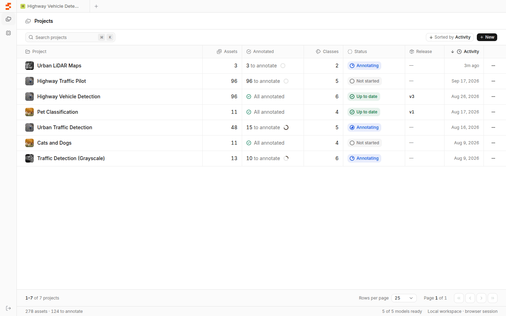
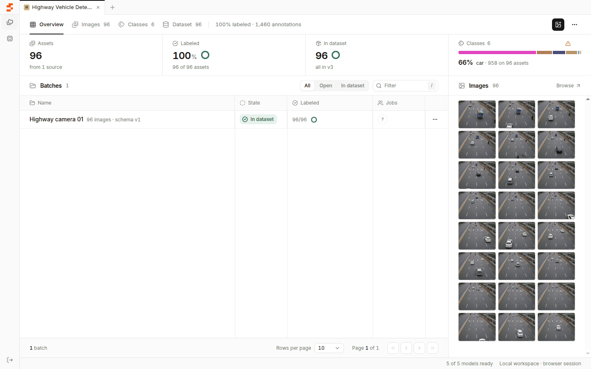
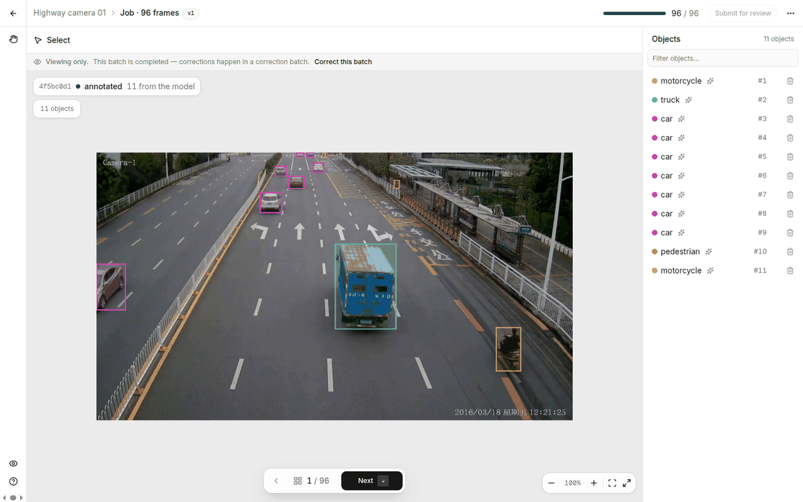
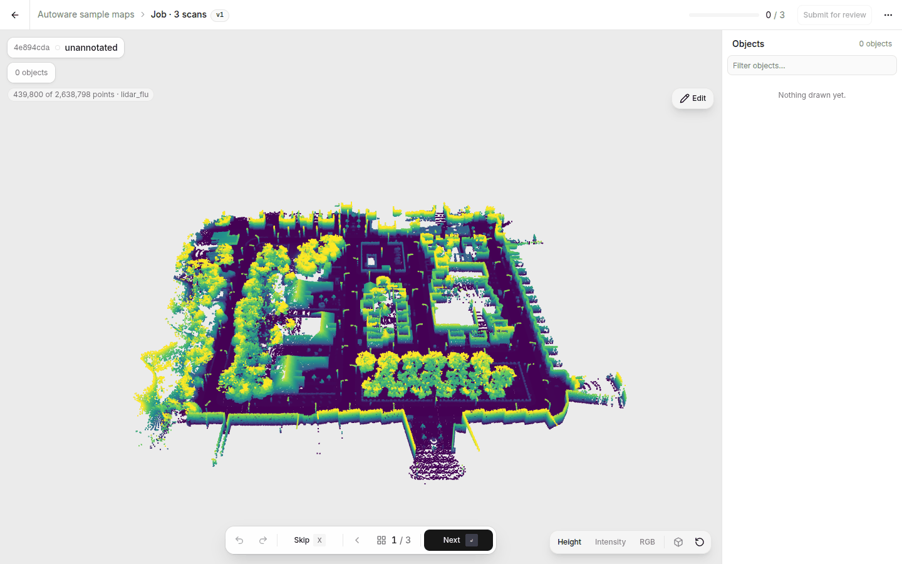

# VisionSet documentation

VisionSet helps you create, curate, and version computer-vision datasets in a local workspace.
Bring in images, video frames, point-cloud scans, or an existing labeled dataset. Organize
annotation work into batches, promote reviewed labels to the dataset, and publish an immutable
release that you can export for training.

[Install VisionSet](install.md) and follow the [first dataset tutorial](tutorial.md) to try the
workflow. The [examples](examples.md) show how to run it through the Python SDK, REST API, CLI,
and MCP. These pages describe the repository's `main` branch. See the
[installation guide](install.md#install) for the difference between the published beta and a build
from source.

## VisionSet at a glance

These screenshots show a local workspace with labeled traffic frames and point-cloud scans.

| | |
| --- | --- |
|  |  |
| **Projects.** Browse projects and see asset counts, annotation progress, and the latest release. | **Overview.** See a project's batches, assets, and class distribution. |
|  |  |
| **Image annotation.** Draw labels on images and video frames in the [annotator](ui/annotator.md). | **Point-cloud annotation.** Draw cuboids and 3D polylines in the scan's declared [coordinate frame](media.md). |

## Work with a dataset

| I want to… | Read |
| --- | --- |
| Bring in raw or labeled data | [Sources](sources.md), [ingest](ingest.md), [labeled dataset import](import.md), and [media](media.md) |
| Set up a workspace and project | [Workspaces](workspaces.md), [projects](projects.md), and [schemas](schemas.md) |
| Assign annotation work and review labels | [Batches](batches.md), [annotation jobs](jobs.md), [annotations](annotations.md), and [model-assisted labeling](inference.md) |
| Publish and export training data | [Datasets](datasets.md), [releases and export targets](releases.md), [preprocessing](preprocessing.md), and [MLflow tracking](tracking.md) |
| Look up a term | [Glossary](glossary.md) |

## Choose an interface

The [surface comparison](surfaces.md) shows which operations are available in each interface.

| Interface | Guides and reference |
| --- | --- |
| Browser | [Browser client](ui.md), [navigation](ui/navigation.md), and [annotator](ui/annotator.md) |
| Python SDK | [Examples](examples.md) and [kernel architecture](architecture/backend/kernel.md) |
| REST API | [API conventions](api.md), [authentication](auth.md), and [error codes](error-codes.md) |
| CLI | [CLI guide](cli.md) |
| MCP | [Server setup](mcp.md), [walkthrough](mcp-walkthrough.md), and [generated tool reference](mcp-tools.md) |

## Contribute to VisionSet

Start with the repository [README](../../README.md) and [contributing guide](../../CONTRIBUTING.md).
The [architecture overview](architecture/README.md) explains the package boundaries and links to
the [architecture decisions](architecture/decisions/README.md). For runtime behavior, see
[persistence](persistence.md), [events](events.md), and [background jobs](background-jobs.md).

For interface changes, see the [visual design contract](../../DESIGN.md), the [UI product
principles](ui/product-principles.md), and the [navigation rules](ui/navigation.md). The
[release runbook](releasing.md) covers publishing the Python and npm packages.
