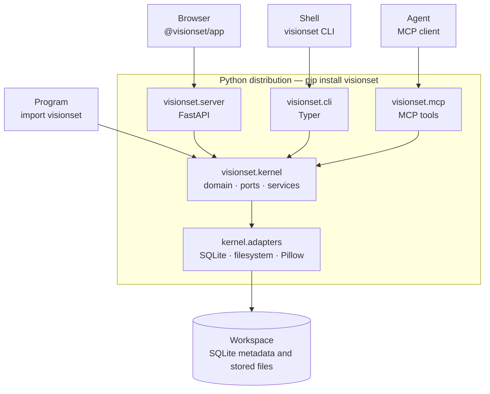

# Architecture

The Python SDK owns VisionSet's dataset model and workflows. The REST API,
CLI, and MCP server call it directly. The browser reaches it through the REST
API and handles browser-specific work such as video decoding and on-device
inference.

These pages cover package responsibilities, dependency boundaries, and the checks
that enforce them. See the [documentation index](../README.md) for product behavior.

## The system

The arrows show how calls reach a workspace. [Import-linter contracts](../../../pyproject.toml)
enforce kernel purity and keep the delivery packages independent. A
[fresh-process test](../../../tests/architecture/test_kernel_purity.py) checks
what loading the kernel actually imports.

## The two halves

| Half | Lives in | Ships as | Page |
| --- | --- | --- | --- |
| Python distribution | [`src/visionset/`](../../../src/visionset/) | a `pip` wheel | [backend/](backend/README.md) |
| Frontend workspace | [`frontend/`](../../../frontend/) | npm packages, and a bundle inside the wheel | [frontend/](frontend/README.md) |

The wheel includes the compiled browser bundle in `visionset/_static/`.
`visionset server` serves it under `/app`.

## Where to go next

- [Backend](backend/README.md) maps the Python packages and their import contracts.
- [Frontend](frontend/README.md) covers the five workspace packages and their dependencies.
- [Cross-cutting rules](cross-cutting.md) cover host adapters, capabilities, and the batch lifecycle.
- [Decisions](decisions/README.md) document constraints that apply across layers.

See [the visual contract](../../../DESIGN.md) for design guidance and the
[contribution guide](../../../CONTRIBUTING.md) for local checks.
