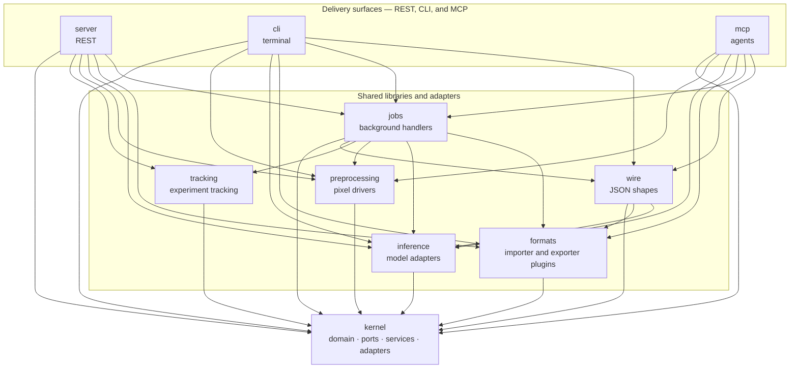

# The backend

The Python distribution in [`src/visionset/`](../../../../src/visionset/) contains
the dataset SDK, shared adapters, and three delivery packages. The kernel
defines the domain and use cases. The server, CLI, and MCP server compose those
services with the adapters each surface needs.

## The stack

The arrows show current package dependencies. The import contracts below
keep the kernel independent of the surrounding packages and keep the three
delivery surfaces independent of each other.

## The packages

| Package | What it is | Page |
| --- | --- | --- |
| [`kernel`](../../../../src/visionset/kernel/) | The domain, the ports, the services, and the default adapters. Everything else is a client of it. | [kernel.md](kernel.md) |
| [`server`](../../../../src/visionset/server/) | FastAPI routes, Pydantic request and response models, and HTTP error mapping. | [server.md](server.md) |
| [`cli`](../../../../src/visionset/cli/) | Typer. The whole cycle from a shell. | [cli.md](cli.md) |
| [`mcp`](../../../../src/visionset/mcp/) | The MCP tool surface, for agents. | [mcp.md](mcp.md) |
| [`formats`](../../../../src/visionset/formats/) | Exporter and importer plugins, discovered by entry point. | [formats.md](formats.md) |
| [`preprocessing`](../../../../src/visionset/preprocessing/) | Pre-processing drivers - the Pillow resize and augmentation engines behind the `PreprocessingDriver` port - discovered over the `visionset.preprocessing` entry-point group the way exporters are. | [preprocessing-drivers.md](preprocessing-drivers.md) |
| [`wire`](../../../../src/visionset/wire/) | The JSON shapes the CLI and MCP publish. | [wire.md](wire.md) |
| [`jobs`](../../../../src/visionset/jobs/) | Handlers for work that outlives a request. | [jobs.md](jobs.md) |
| [`inference`](../../../../src/visionset/inference/) | Model provider discovery, weight handling, and local inference and pre-labeling. | [inference.md](inference.md) |
| [`tracking`](../../../../src/visionset/tracking/) | Optional MLflow experiment tracking: a neutral `Tracker`, a no-op default, and an MLflow client imported only when tracking is enabled. | [tracking.md](../../tracking.md) |

## What the rules are, and where they live

Eight import-linter contracts in [`pyproject.toml`](../../../../pyproject.toml) hold
the graph above. They are run by `uv run lint-imports`, which
[`scripts/check.sh`](../../../../scripts/check.sh) invokes.

| Contract | What it forbids |
| --- | --- |
| Kernel purity | `visionset.kernel` importing `server`, `cli`, `mcp`, `formats`, `wire`, `jobs`, `inference`, `preprocessing`, `tracking`, or `fastapi` / `typer` / `mcp` / `uvicorn` / `mlflow` |
| Delivery clients are siblings | `server`, `cli` and `mcp` importing each other |
| Job handlers are below the surfaces | `visionset.jobs` importing any delivery package or web framework (`fastapi` / `typer` / `mcp` / `uvicorn`) |
| Inference adapters are below the surfaces | `visionset.inference` importing any delivery package, web framework (`fastapi` / `typer` / `mcp` / `uvicorn`), or `visionset.jobs` |
| Tracking is below the surfaces | `visionset.tracking` importing any delivery package, `jobs`, `inference`, `formats`, `preprocessing`, `wire`, `kernel.services`, `kernel.adapters`, or `fastapi` / `starlette` / `typer` / `click` / `mcp` / `uvicorn` |
| Shared libraries are below the surfaces | `wire`, `formats` and `preprocessing` importing `server`, `cli`, `mcp`, or `fastapi` / `starlette` / `typer` / `click` / `mcp` / `uvicorn` |
| Shared libraries never touch the database driver | `wire`, `formats`, `preprocessing` and `tracking` importing `sqlalchemy` directly |
| Format plugins never reach a workspace | `formats` importing `visionset.kernel.services` or `visionset.kernel.adapters` directly - an importer reads a directory and returns a value |

The [kernel purity test](../../../../tests/architecture/test_kernel_purity.py)
also imports the kernel in a fresh interpreter and checks `sys.modules` for
forbidden modules. This covers imports triggered while the kernel loads,
including those reached indirectly.

See [cross-cutting rules](../cross-cutting.md) for the shared boundaries and
[the kernel](kernel.md) for what belongs inside the SDK.
