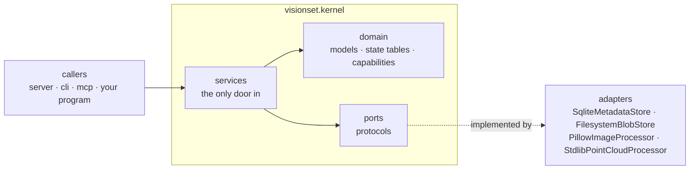

# kernel

[`src/visionset/kernel/`](../../../../src/visionset/kernel/) is the part of VisionSet
that defines projects, batches, and releases and runs their workflows. Services
coordinate domain rules and depend on ports for operations such as storage,
image processing, and export.

## Ports and adapters

`ports` declares protocols and nothing else - a `MetadataStore`, a `BlobStore`, an
`ImageProcessor`, a `PointCloudProcessor`, an `EventBus`, a `JobQueue`, an
`AuthProvider`, a `ProgressReporter`, an `Exporter`, an `Importer` (with its optional
`OpensPictures`), a
`ModelProvider`, a `PreprocessingDriver`. There is no `VideoProcessor` port: video
decoding happens in the browser
([`frontend/media`](../frontend/media.md)) and the kernel never sees a video file,
only the image assets a browser-side materializer already produced. `adapters` holds
the implementations this distribution ships for the storage, queue, event, progress, auth, image and
point-cloud ports - `StdlibPointCloudProcessor` reads PCD and PLY scans with the standard library
and draws their thumbnail with Pillow; an `Exporter` or a
`PreprocessingDriver` is implemented outside the kernel, in `visionset.formats` and
`visionset.preprocessing`, and handed in as an instance.
A service names a port, never an adapter, which is what lets a test drive a
service against an object literal.

## The four directories

| Directory | Holds | Rule |
| --- | --- | --- |
| [`domain/`](../../../../src/visionset/kernel/domain/) | pydantic models, the transition tables, the capability tables | Pure values. Imports nothing from the rest of the kernel. |
| [`ports/`](../../../../src/visionset/kernel/ports/) | `Protocol` declarations | Signatures name domain types and standard-library types. Nothing else. |
| [`services/`](../../../../src/visionset/kernel/services/) | workspace operations and use cases | Services use an open `WorkspaceService` to reach its ports. |
| [`adapters/`](../../../../src/visionset/kernel/adapters/) | SQLite, the filesystem, Pillow, the standard-library scan reader | Adapters implement the storage and processing protocols. |

## The purity contract

The kernel may not import `visionset.server`, `visionset.cli`, `visionset.mcp`,
`visionset.formats`, `visionset.wire`, `visionset.jobs`, `visionset.inference`,
`visionset.preprocessing`, or `visionset.tracking`. The same contract forbids
`fastapi`, `typer`, `mcp`, `uvicorn`, and `mlflow`.

The obvious half is that a domain must not depend on a delivery mechanism. The
less obvious half is why `formats`, `wire`, `jobs`, `inference` and `preprocessing`
are on the list when none of them is a web framework: each is a place where a
*decision about the outside world* is made - which plugin exists, what gets
published, what runs in a worker, which model is loaded, which engine moves the
pixels - and a kernel that could reach one could reach the thing behind it.
`ReleaseService.export` takes an `Exporter` **instance**, and its `drivers=` takes
`PreprocessingDriver` instances, for exactly this reason: resolving a name to a
plugin is discovery at runtime, and the kernel is the part that must not do any.

The static contract and runtime test cover different import paths.

- [`pyproject.toml`](../../../../pyproject.toml) - the `Kernel purity` import-linter
  contract, run by `uv run lint-imports`.
- [`tests/architecture/test_kernel_purity.py`](../../../../tests/architecture/test_kernel_purity.py)
  imports the kernel in a fresh interpreter and inspects `sys.modules` for
  forbidden modules loaded during initialization.

The kernel is also the one package `mypy` checks in strict mode. The strict flags are
per-module configuration, so `uv run mypy src/visionset` - what CI runs - applies them here
and the ordinary ones everywhere else; `uv run mypy src/visionset/kernel` is the kernel-only
subset for iterating, and sees nothing outside the kernel.

## Where the behaviour is written down

This page is about arrangement. What the services actually do has its own pages:
[workspaces](../../workspaces.md), [projects](../../projects.md),
[schemas](../../schemas.md), [sources](../../sources.md), [ingest](../../ingest.md),
[batches](../../batches.md), [jobs](../../jobs.md),
[annotations](../../annotations.md), [datasets](../../datasets.md),
[releases](../../releases.md), [preprocessing](../../preprocessing.md),
[events](../../events.md),
[persistence](../../persistence.md) and [media](../../media.md).

Routes, commands, and tools validate surface-specific input, compose service
calls, and format the result. The kernel owns business rules and raises domain
errors. Delivery packages translate those errors into HTTP statuses, CLI exit
codes, or MCP error results.
