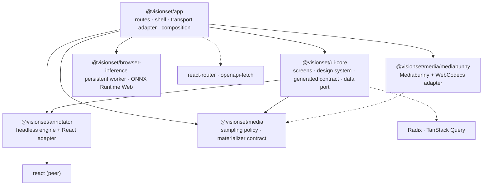

# The frontend

The [frontend workspace](../../../../frontend/) contains five pnpm packages.
The app composes the reusable UI, annotation, media, and inference packages.

## The five packages



Solid arrows show workspace dependencies and the media adapter subpath.
Dotted arrows show external library relationships.

| Package | Depends on | Never |
| --- | --- | --- |
| [`annotator`](annotator.md) | nothing at runtime; the root entrypoint is headless, and the optional `react` peer is touched only by the `./react` subpath | HTTP, a design system, a router |
| [`media`](media.md) | nothing at runtime (core); its own `./mediabunny` subpath depends on `mediabunny` and the browser | React, HTTP, routing, a host — and the core entrypoint never touches `window`, `Worker` or `VideoDecoder` at module scope |
| [`ui-core`](ui-core.md) | `@visionset/annotator` (root and `./react`), `@visionset/media` **root entrypoint only**, Radix, TanStack Query; `openapi-fetch` is a dependency for consumer-resolvable type references in emitted declarations, never a runtime/value import | a router, HTTP, `@visionset/media/mediabunny`, or which transport a `FrameSink` uses |
| [`app`](app.md) | `ui-core`, `annotator` and its React adapter, `media` and its Mediabunny adapter, `browser-inference`, `react-router`, and `openapi-fetch` | domain logic |
| [`browser-inference`](browser-inference.md) | `onnxruntime-web` | application screens, model acquisition, or the `ui-core` port |

The annotator's headless engine has zero runtime dependencies. The media core
defines the materializer contract, and the app loads the Mediabunny decoder
through its own subpath. The app also adapts the browser inference runtime to
the suggestion port in `ui-core`. Reusable screens receive navigation through
callbacks and data, media, and inference through host-supplied ports.

## What the workspace runs

```
pnpm -r build     # tsc, and vite for the app
pnpm -r test      # vitest
pnpm -r lint      # eslint, plus the annotator's two typecheck passes
```

The default package tests use Vitest. Separate Playwright suites cover the
app against a stubbed API, the app against a real VisionSet server, browser
video decoding, and browser inference. The media and inference packages each
expose a `test:browser` script. The
[local check runner](../../../../scripts/check.sh) and
[CI workflow](../../../../.github/workflows/ci.yml) also run the browser suites.

The bundle the app produces is copied into `src/visionset/_static/` and served by
`visionset server` under `/app`, which is why one `pip install` is the whole
product.

## Where to go next

- [annotator.md](annotator.md) - the headless engine and the boundary that keeps
  it headless.
- [media.md](media.md) - browser video import: the sampling policy, the
  core/adapter split, and the worker's back-pressure.
- [ui-core.md](ui-core.md) - screens, the design system, and the generated contract.
- [App](app.md) covers routing, sessions, and host adapters.
- [Browser inference](browser-inference.md) covers model execution and worker lifecycle.
- [Visual baselines](visual-baselines.md) covers screenshot comparison and baseline updates.

[`DESIGN.md`](../../../../DESIGN.md) is the visual contract and the file to read
before building any screen; the product's own UI rules are
[`docs/content/ui/product-principles.md`](../../ui/product-principles.md),
[`docs/content/ui/navigation.md`](../../ui/navigation.md) and
[`docs/content/ui/annotator.md`](../../ui/annotator.md). [`docs/content/ui.md`](../../ui.md) covers
how the browser client talks to the API. [`docs/content/annotations.md`](../../annotations.md)
covers the annotator's own behaviour.
