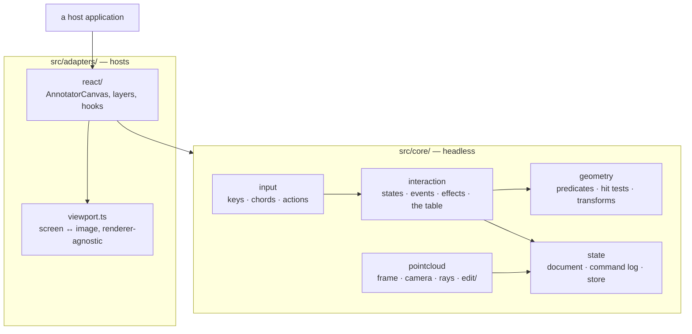

# @visionset/annotator

[`frontend/annotator/`](../../../../frontend/annotator/) is the annotation engine. Its
whole claim is that the part which *decides* anything - geometry, hit testing, the
interaction state machine, undo - is pure TypeScript that has never heard of a
browser, and React is one renderer over the top of it.

## The boundary

`src/core/` may not import React and may not name a browser global. Everything
that needs one lives in `src/adapters/`. `viewport.ts` sits at the adapter root
rather than under `react/` because it is arithmetic, and arithmetic has no host.

## Three gates, and each catches something the others cannot

All three run under `pnpm --filter @visionset/annotator lint`.

| Gate | Where | Catches |
| --- | --- | --- |
| `no-restricted-imports` | [`eslint.config.js`](../../../../frontend/annotator/eslint.config.js), scoped to `src/core/**` | a React import |
| `no-restricted-globals` | same file, same scope | a browser host object used as a **value** |
| `tsconfig.core.json` | [`tsconfig.core.json`](../../../../frontend/annotator/tsconfig.core.json) | a DOM type in a **signature** |

The third is the one worth understanding. It compiles the shipped engine with
`lib: ["ES2022"]` and `types: []` - no DOM library, no ambient `@types` - so
`function onKey(e: KeyboardEvent)` inside core fails to compile. A lint rule
reading *value* references is structurally blind to that, because a type
annotation is not a value reference, and it is exactly the shape that leaked into
v1's supposedly-pure layer.

That each gate actually fires is itself proved:
[`tests/scripts/annotator_boundary.test.mjs`](../../../../tests/scripts/annotator_boundary.test.mjs)
introduces a violation of each and asserts the corresponding gate rejects it.

## How a host talks to it

The engine takes wire-shaped input and hands back wire-shaped output, with no
mapping layer: `src/core/types.ts` mirrors the API's own shapes - `snake_case`
fields, geometry nested under its own key, points as `[x, y]` pairs - and
`src/core/wire.ts` parses `unknown` into them.

What travels the other way is a document, never HTTP. `AnnotatorCanvas` fetches
nothing; a host reads the annotations, hands them over, and writes back what the
store reports. That is the same split the suggest tool has: the engine owns the
*shape* of a suggestion session and the host owns the request.

### A new wire field is not additive here

`parseAnnotation` checks the key set **exactly**: a payload carrying a field the mirror does
not declare is *refused*, not ignored. That is what makes the mirror a contract rather than a
suggestion, and the consequence is that adding a field to a kernel wire model is a breaking
change to this client until every mirror moves with it, **in the same commit**:

| Where | What moves |
| --- | --- |
| [`src/visionset/server/models.py`](../../../../src/visionset/server/models.py) | the field on `AnnotationOut`, and the `visionset/wire/`, MCP and CLI projections |
| [`frontend/annotator/src/core/types.ts`](../../../../frontend/annotator/src/core/types.ts) | the field on `Annotation` |
| [`frontend/annotator/src/core/wire.ts`](../../../../frontend/annotator/src/core/wire.ts) | `ANNOTATION_KEY_SET` **and** the `parseAnnotation` body |
| [`frontend/ui-core/src/annotator/jobQueries.ts`](../../../../frontend/ui-core/src/annotator/jobQueries.ts) | `WireAnnotation`, which is a second mirror on purpose |

Then regenerate the fixture — `uv run python scripts/export_wire_fixtures.py` writes
`tests/fixtures/wire_annotations.json` from the same pydantic models `openapi.json` comes
from — and give any in-core factory a value. Never hand-write a TypeScript copy of a kernel
shape: extend the exporter and regenerate, which holds both gates in step.

A field the *service* stamps stays off `AnnotationCreate`/`AnnotationUpdate`. A field a client
could set and never observe is a lie in the schema.

## The scan editor is a sibling, not a widening

A point-cloud scan's labels are cuboids and polylines in the frame its source declares, and they are edited
by a second engine under `src/core/pointcloud/edit/` rather than by pushing 3D through the
image engine. `Geometry`, `Annotation` and the image interaction machine stay 2D, so every
dispatch over them stays exhaustive without a 3D arm; the 3D variants never enter
`AnnotationDocument`.

| Piece | Image engine | Scan editor |
| --- | --- | --- |
| Document | `AnnotationDocument` (`documentFromWire`) | `ScanDocument` (`scanDocumentFromWire`), `cuboid_3d` and `polyline_3d` |
| History, preview, selection | `CommandLog`, `AnnotatorStore`, `Selection` | the same classes, generic over the document |
| Picking | `geometry/hitTest` in asset pixels | `pointcloud/ray` (screen to ray, ray vs ground and cuboid) and `edit/scene` (handles, vertices, segments, bodies) |
| Machine and effects | `interaction/machine`, `Effect` | `edit/machine`, `ScanEffect`, `runScanEffects` |
| Save | `planSave` | `planScanSave` |

The two save plans are disjoint over one scan: `planSave` carries every 3D label past, and
`planScanSave` carries past everything that is not a cuboid or a 3D polyline, so a page can send both through
the same job-scoped calls. The scan plan wraps a yaw into `[-π, π]`, because the kernel
refuses one outside rather than wrapping it, and sends the stored provenance, so an edited
import stays `import`.

On a scan, `yaw` turns about the declared frame's up axis. `scanCuboidCorners` draws that
convention and `pointcloud/cuboid` is its inverse, so an edit writes back exactly what the
viewer read and no coordinate is re-expressed in another frame. A source that declares no
frame is drawn in a default frame while the kernel refuses every 3D write on it, so
`scanEditability` reports editing off there, with the reason.

In a host, `PointCloudCanvas` takes `editing`: primary presses then go to `onScanPointer` with
the camera and the CSS-pixel viewport they were made through (`scanPointerRole` decides which
button edits, orbits or pans), and `onCameraChange` reports every camera move. `useScanEditor`
turns those events through the machine against the store, and `scanHandleLayout` places the
selected box's handles with the same `screenOf` the hit test measures against. Selected and
draft boxes go through the canvas's one lines buffer, flagged with an `emphasis` that draws them
in `highlightColor`. In `ui-core`, `useScanWorkspace` holds the scan store beside the image
store on the annotation page, and `mergePlans` joins the two save plans into one dirty state.

The top-down view is a second `PointCloudCanvas` with `pinned`: its camera is `topDownCamera`,
straight down the up axis and **orthographic** (`OrbitCamera.projection`), because a perspective
camera that close draws a box's top visibly larger than its footprint. `ndcRay`, `screenOf`,
`metresPerPixel` and `viewProjection` each take the orthographic case, so the machine, the hit
test and `scanHandleLayout` are unchanged. It follows the perspective camera's target through
`followTarget` and turns its orbit drag into a pan (`scanPointerRole(…, pinned)`). Both views feed
the one `useScanEditor`; each `ScanView` names its `kind`, which reaches the machine as
`Scene3D.view`. A `top-down` view offers only the four side faces (`handleFaces`) and never reads
a height, so a draw can take its footprint there and its height in the perspective view.

Polylines use the same machine, store and save plan. The machine adds a `drawing-polyline`
state (the vertices placed so far and the cursor, previewed through `draftPolyline`) and a
`moving-vertex` state; vertex edits are the pure `pointcloud/polyline` functions
(`movePolylineVertex`, `insertPolylineVertex`, `removePolylineVertex`, `isDrawablePolyline`).
Every vertex is placed with `rayGroundHit` at the ground height, and a dragged vertex keeps its
own level; no vertex is picked from the scan's points. `commit` (Enter, or a double-click the
adapter maps to it) adds the line only when it has two vertices not all equal, the kernel's
rule, and otherwise keeps drafting. `hitTest3D` tries the selected label's handles first - a
polyline's vertices or a cuboid's faces and yaw ring - then any polyline's segments, then cuboid
bodies. A press on a segment of the selected polyline inserts a vertex and drags it as one
command; alt on a vertex removes it, refused below two; alt anywhere else does nothing; a removal
or drag that `isDrawablePolyline` rejects is refused, so the document never holds a line the kernel
would refuse; `delete-selected` removes whole labels. A polyline is created with `visibility`
omitted, which the kernel reads as unknown; a declared visibility stays aligned with the points,
an inserted vertex taking `UNLABELED`. `scanVertexLayout` places the vertex handles with the same `screenOf` as the hit test.

## Zero runtime dependencies

`package.json` has no `dependencies` at all. The root entrypoint is headless and never
imports `react`; the React adapter is the separate `@visionset/annotator/react` subpath, and
`react` is an optional `peerDependency` needed only by that subpath. `ui-core` and the app
consume both. An application embedding the engine inherits nothing - which is also why the styled annotation panel lives in
`ui-core` and not here: a design system inside `adapters/react` would be the first
thing an embedder had to fight.

## Related

[`docs/content/annotations.md`](../../annotations.md) covers the behaviour - the tools,
the shortcut table, the ceiling on zoom.
